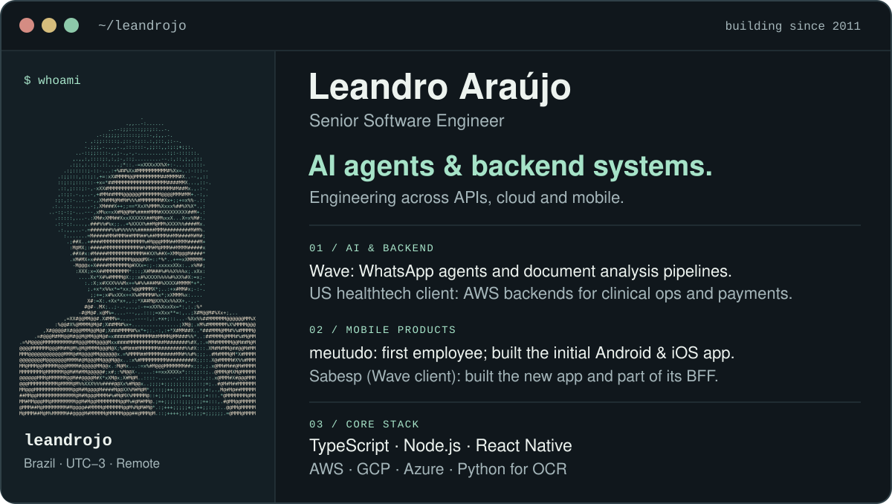

<!-- Artwork is pinned to its commit so GitHub does not serve an older cached cover. Update both URLs when replacing the artwork. -->
<picture>
  <source media="(max-width: 640px)" srcset="https://raw.githubusercontent.com/leandrojo/leandrojo/08f0352e7c5516a6bce1f00eb74fde419e51ffbc/profile-mobile.svg">
  
</picture>

  <a href="https://github.com/leandrojo/forum">Forum · multi-model debates</a>
  &nbsp; · &nbsp;
  <a href="https://www.linkedin.com/in/leandroresume/">LinkedIn</a>
  &nbsp; · &nbsp;
  <a href="mailto:contato@leandroaraujo.me">Contact</a>

